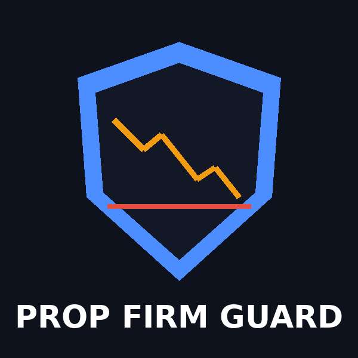
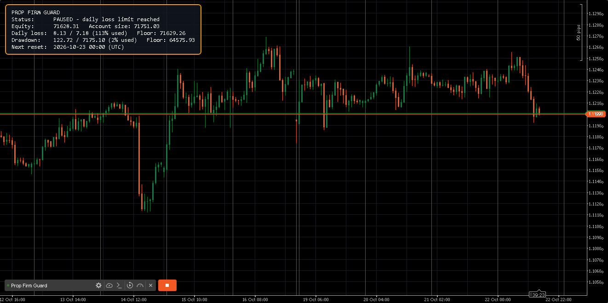
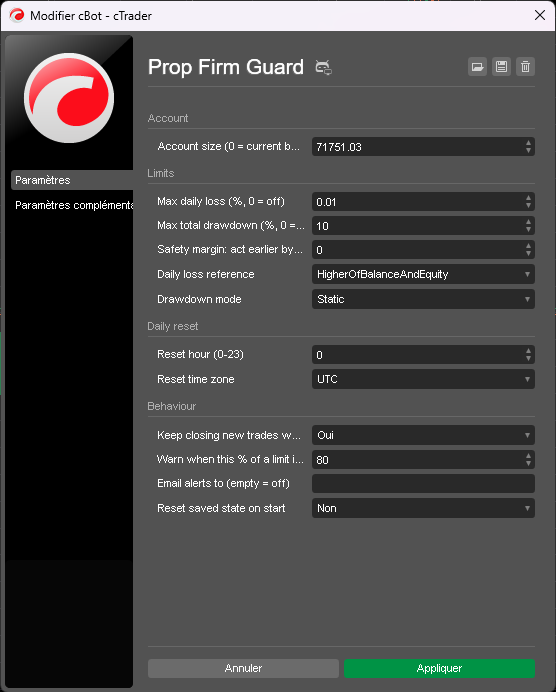
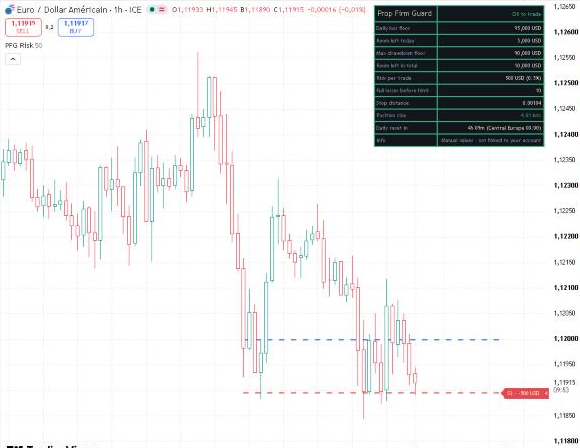

# Prop Firm Guard

**Free daily loss and max drawdown protection for prop firm accounts, for MetaTrader 5 and cTrader, plus a risk and position size panel for TradingView.**

Prop Firm Guard protects challenge and funded accounts from the two rules that end most prop firm accounts: the **daily loss limit** and the **maximum drawdown**. It never opens trades. Attach it to any chart, keep trading as usual (manually or with other bots), and it checks your equity every second. As soon as a limit is reached, it:

- closes every open position on the account
- deletes every pending order
- closes any new trade opened while the limit is still hit (optional)
- alerts you (popup, plus push notification on MT5 or e-mail on cTrader)

The daily lock lasts until the next daily reset. The max drawdown lock stays until you reset it yourself.

## Features

| | MetaTrader 5 | cTrader |
|---|:---:|:---:|
| Daily loss limit (% of account size) | ✅ | ✅ |
| Max drawdown, static or trailing | ✅ | ✅ |
| Daily reference: balance, or higher of balance and equity | ✅ | ✅ |
| Safety margin (act before the real limit) | ✅ | ✅ |
| Early warning at X% of a limit | ✅ | ✅ |
| State saved across restarts | ✅ | ✅ |
| Daily reset hour | Server time | UTC, New York, London or Central Europe, daylight saving handled |
| Alerts | Popup + push | Popup + e-mail |
| On-chart status panel | ✅ | ✅ (green / orange / red) |

## Installation

### MetaTrader 5
1. Copy [`MetaTrader5/PropFirmGuard.mq5`](MetaTrader5/PropFirmGuard.mq5) to `MQL5/Experts/` (File > Open Data Folder).
2. Compile it in MetaEditor (F7).
3. Drag it onto any chart, enable **Algo Trading**, and set your prop firm limits.

### cTrader
1. In cTrader, open **Algo > cBots > New**, name it `Prop Firm Guard`.
2. Replace the code with [`cTrader/PropFirmGuard.cs`](cTrader/PropFirmGuard.cs) and click **Build**.
3. Start it on any chart with your prop firm limits. No access rights are required.

## Parameters

| Parameter | Default | Description |
|---|---|---|
| Account size | 0 | Starting balance of your challenge (0 = current balance) |
| Max daily loss (%) | 5 | Daily loss limit, 0 = off |
| Max total drawdown (%) | 10 | Overall drawdown limit, 0 = off |
| Safety margin (%) | 0 | Acts this much earlier, to absorb slippage and spread |
| Daily loss reference | Balance | Balance, or higher of balance and equity at the start of the day |
| Drawdown mode | Static | Static (from account size) or trailing (from highest equity) |
| Reset hour | 0 | Hour of the daily reset (check your prop firm's rules) |
| Keep closing new trades | true | Closes any trade opened while a limit is hit |
| Warn at (%) | 80 | Alert when this share of a limit is used, 0 = off |
| Reset saved state | false | Clears the saved state and unlocks a max drawdown block |

## TradingView: Risk Panel

TradingView scripts cannot read your account or close trades, so the TradingView version is a **risk and position size panel** rather than an automatic guard. You enter your account size, start-of-day balance and current equity (from your prop firm dashboard), and it shows:

- the daily loss floor and the room left today
- the max drawdown floor (static or trailing) and the room left in total
- how many full losses you can take before a limit is hit
- the **position size** for your next trade: click your entry and stop loss on the chart, and it converts the risk into lots or units, in your account currency
- a countdown to the daily reset (Central Europe, New York, London or UTC, daylight saving handled)
- a green / orange / red status

**Installation:** open the **Pine Editor** at the bottom of a TradingView chart, replace its content with [`TradingView/PropFirmGuard.pine`](TradingView/PropFirmGuard.pine), click **Add to chart**, then click your entry price and stop loss on the chart. Works with a free TradingView account.

## Important

- Check the exact rules of your prop firm (limit values, daily reset time, balance or equity reference) and set the parameters accordingly. Rules differ between firms.
- Prop Firm Guard reacts to the prices it receives. In fast markets, gaps or slippage, the final loss can be larger than the limit. Use the safety margin to act earlier.
- The protection only works while the platform is running and connected. Use a VPS if you trade while your computer is off.
- This tool helps you respect risk limits. It does not guarantee that you will pass a challenge or keep a funded account. Trading leveraged products carries a high risk of losing capital.

## Need a custom bot?

Prop Firm Guard is made by **[propbotstudio.fr](https://propbotstudio.fr/en/)**: custom trading bots and indicators for **cTrader, NinjaTrader, MetaTrader 4/5 and TradingView**, with prop firm rules built in (daily loss, max drawdown, position sizing, trading hours, news and weekend filters). Fixed prices, source code included, everything handled in writing in English or French.

👉 **[propbotstudio.fr/en](https://propbotstudio.fr/en/)** · contact@propbotstudio.fr

## License

[MIT](LICENSE): free to use, modify and share, including commercially. Provided as is, without warranty.
